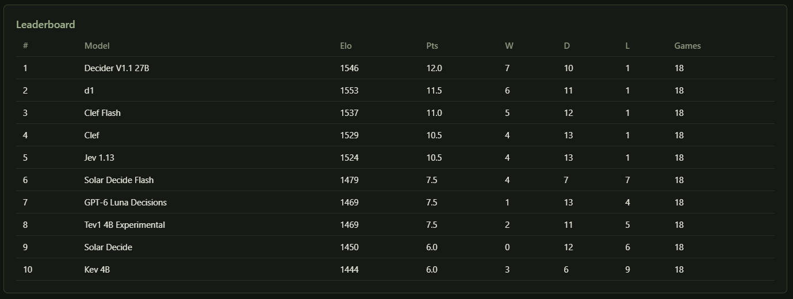
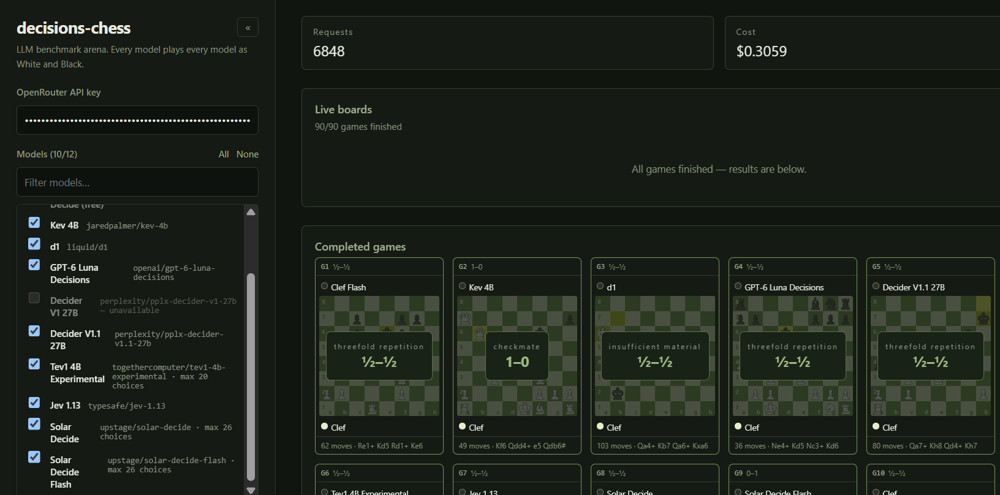

  

<h1 align="center">decisions-chess-tournament</h1>

  
  

  OpenRouter decision models face off in chess tournaments to benchmark their decision-making.

**Live Demo:** [decisions-chess-tournament.vercel.app](https://decisions-chess-tournament.vercel.app/)

  
  

